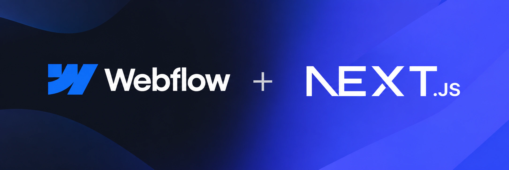
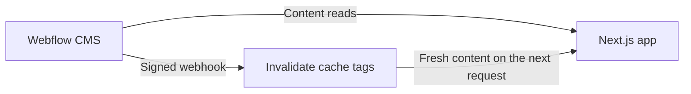

**Webflow CMS for Next.js.**

Typed content, signed draft previews, and webhook-driven cache revalidation. Let editors manage content in Webflow while you build the experience in React.

[](https://github.com/crashncrow/next-webflow/actions/workflows/ci.yml)
[](LICENSE)

[Documentation](packages/next-webflow/README.md) · [Live demo](https://nextjswebflow.vercel.app/) · [Example app](examples/blog) · [Try the beta](#try-the-beta)

> **Pre-release:** `0.1.0-beta.1`, not yet published to npm. You can try the package locally using the instructions below.

## Your CMS, a typed client

Generate a client from your site's collections, then read content in a Server Component:

```tsx
// app/page.tsx
import Link from "next/link";
import { getItems } from "@/webflow";

export default async function Blog() {
  const posts = await getItems("posts", { limit: 10 });

  return (
    <main>
      {posts.map((post) => (
        <Link key={post.id} href={`/posts/${post.fieldData.slug}`}>
          {post.fieldData.name}
        </Link>
      ))}
    </main>
  );
}
```

`@/webflow` is the client generated by `next-webflow typegen`; `@/` is your app's TypeScript path alias. The example assumes a collection with the slug `posts`. You can choose a different output folder with `--out`.

## Why next-webflow?

Every team that puts Webflow content on a Next.js site writes the same glue: a fetch wrapper, hand-written types that drift from the CMS, a cache that's either stale or skipped, a webhook route, a preview workaround. next-webflow is that glue, built once and tested against the real Webflow API.

- **Catch CMS changes before your visitors do.** Types come from your actual collections, fields, and Option values. Run `next-webflow typegen --check` in CI, and a field renamed in Webflow fails your build instead of breaking a page in production.
- **Publish in Webflow, live on the next request.** Reads are cached by Next.js with tags per site, collection, and item. A signed webhook invalidates exactly what changed: no full rebuilds, no waiting for a cache to expire.
- **Previews your editors can actually use.** Signed, expiring links open staged content inside your app, with a draft banner and an exit control. The secret never appears in a URL.
- **Data you can render as is.** Option fields arrive as `{ id, name }`, references resolve into full items (`include: ["author"]`), and empty fields are normalized.
- **Safe Rich Text by default.** The Data API returns Rich Text HTML exactly as stored, scripts and event handlers included. `WebflowRichText` sanitizes it, turns internal links into `next/link`, and lets you swap any element for your own components.
- **Gentle on rate limits.** Pagination, `Retry-After` handling, a cap on concurrent requests, and builds that read one list per collection instead of making one request per page.

See the [API documentation](packages/next-webflow/README.md#reading-content).

### When to use it

**A good fit** if editors manage content in Webflow and developers build the site in Next.js (App Router): blogs, editorial and marketing sites, company websites, resource libraries, documentation, and content catalogs. It's most useful when you want instant updates on publish, typed content, and previews without building them yourself.

**Look elsewhere** if you need to write to the CMS or manage sites (use the official SDK, below), if your site is built and hosted entirely in Webflow's Designer, or if you use the Pages Router or another framework. Webflow Cloud works today as a preview; full support is planned for the next version.

## How this relates to the official Webflow SDK

The official [Webflow JavaScript/TypeScript SDK](https://github.com/webflow/js-webflow-api), published as `webflow-api`, provides typed access to the Webflow Data API, including CMS reads and writes, site operations, and OAuth helpers.

`next-webflow` focuses on using Webflow CMS content in a Next.js app:

| Need                                                         | Where it fits                  |
| ------------------------------------------------------------ | ------------------------------ |
| General API access, content writes, or publishing automation | The official `webflow-api` SDK |
| Types generated from your site's collections and fields      | `next-webflow typegen`         |
| Option names and references resolved into items              | `next-webflow`                 |
| Next.js cache tags and webhook-driven revalidation           | `next-webflow`                 |
| Signed draft previews and React rendering components         | `next-webflow`                 |

`next-webflow` is an independent project with its own `fetch`-based client; it does not depend on `webflow-api`. You can use both in the same application: the official SDK for content management and `next-webflow` for cached reads, previews, and rendering.

## From editing to publishing



Editors work in Webflow. Developers control the routes, layouts, and components in Next.js. Draft previews let both teams review changes before publication. CMS writes remain in Webflow or your existing publishing tools.

## Try the beta

Requirements for your app: **Next.js 15 or 16 with the App Router, React 19, and Node.js 22.12+**. To build this repository, use the Node.js version in `.nvmrc` and pnpm.

Until the first npm publication, build and pack the library locally:

```bash
git clone https://github.com/crashncrow/next-webflow.git
cd next-webflow
pnpm install
pnpm build
npm pack ./packages/next-webflow
```

Then, in your Next.js app, install the generated tarball:

```bash
npm install /absolute/path/to/next-webflow/next-webflow-0.1.0-beta.1.tgz
```

Add a site token with **CMS: Read** and your site ID to the app's `.env.local`:

```dotenv
WEBFLOW_CMS_TOKEN=your-site-token
WEBFLOW_SITE_ID=your-site-id
```

Generate the typed client from that app's directory:

```bash
npx next-webflow typegen
```

This creates `webflow/schema.ts` and `webflow/index.ts`. If your `@/` alias points to `src/`, use `npx next-webflow typegen --out src/webflow` instead.

Continue with [webhook setup](packages/next-webflow/README.md#quick-start), [draft previews](packages/next-webflow/README.md#draft-mode-previews), or the complete [example blog](examples/blog).

## Compatibility and validation

| Area           | Coverage                                                                 |
| -------------- | ------------------------------------------------------------------------ |
| Next.js        | App Router on Next.js 15 and 16                                          |
| Runtime        | Node.js 22.12+ and Edge-compatible runtime code; the CLI runs on Node.js |
| Package        | Built ESM entry points, TypeScript declarations, and CLI checks          |
| Caching        | Tests pin request URLs, cache tags, and webhook revalidation behavior    |
| Content safety | Rich Text sanitization and signed draft/webhook verification tests       |
| Webflow API    | Separate contract suite against a real test site                         |

CI checks the supported Node.js matrix and Edge compatibility. The [live demo](https://nextjswebflow.vercel.app) has also been checked with real Webflow content on Vercel: published reads, staged previews, leaving preview, and webhook-driven updates.

Webflow Cloud integration is documented as a **preview** with measured caching requirements. Read the [deployment notes](packages/next-webflow/README.md#webflow-cloud-notes-preview) and [known limitations](packages/next-webflow/README.md#known-limitations) before choosing your setup.

## Documentation and examples

| Resource                                                 | What you will find                                                                 |
| -------------------------------------------------------- | ---------------------------------------------------------------------------------- |
| [Library documentation](packages/next-webflow/README.md) | Setup, reads, field types, references, caching, webhooks, previews, and components |
| [Example blog](examples/blog)                            | A Next.js app combining the library's features                                     |
| [Measurements and notes](docs)                           | Observed API behavior and deployment findings                                      |
| [Webflow Cloud spike](spikes/webflow-cloud)              | The separate app used to verify Webflow Cloud behavior                             |

## Development

To contribute, use the Node.js version in `.nvmrc` and pnpm.

```bash
pnpm install
pnpm format:check
pnpm lint
pnpm build      # before typecheck: the example imports dist/
pnpm typecheck
pnpm test       # Node and Edge tests with mocked API responses
```

The real API contract suite is separate and needs credentials for a test site:

```bash
WEBFLOW_CONTRACT=1 pnpm test:contract
```

Use `pnpm changeset` to describe a library change for the changelog. Report bugs and propose changes through [issues](https://github.com/crashncrow/next-webflow/issues) and pull requests.

## License

This project is licensed under the [MIT License](LICENSE).

---

<p align="center">
  <sub>Made with 🧉 by <a href="https://nnaro.dev">nnaro.dev</a></sub>
</p>
